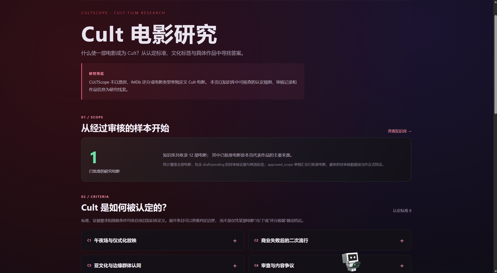
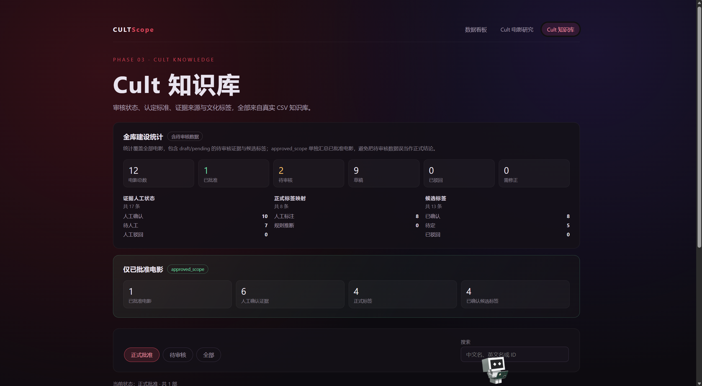
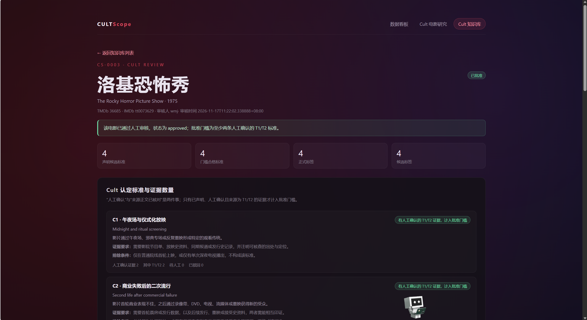
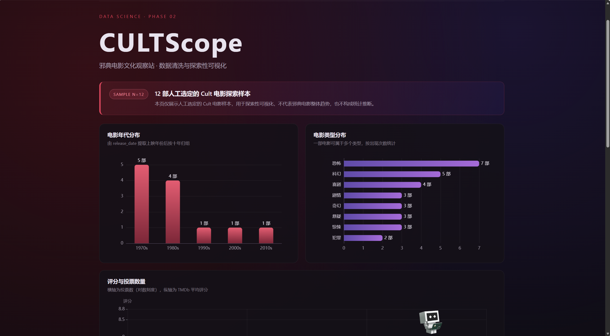

# CULTScope

**以可核查证据研究邪典电影（Cult Film）的个人项目。**

CULTScope 不以评分、票房或榜单来定义一部电影是否为 Cult，而是尝试把「认定标准、来源证据、人工审核、文化标签」组织成可追溯的研究数据，并通过 Vue 3 与 FastAPI 呈现。

> **English summary**
> CULTScope is a personal Cult film research project. It combines a small TMDb sample dashboard, a manually reviewed Cult knowledge base, and a read-only IMDb aggregate API. Instead of ranking films, it records which criteria a film is claimed to meet, which sources support each claim, and whether a human reviewer has confirmed the evidence.

---

## 项目概览

CULTScope 关注的问题是：**一部电影为什么会被认为是 Cult 电影？**

普通的电影网站通常用评分、热度或榜单回答「哪部电影更好」。CULTScope 关注的是研究过程：

- 这个判断依据哪条 Cult 认定标准？
- 哪条来源提供了证据？来源是否可靠？
- 来源正文是否已核对？人工是否确认？
- 这部电影当前是草稿、待审核，还是已批准？
- 它被赋予了哪些文化标签？这些标签是正式记录还是候选建议？

因此，项目同时包含三类彼此独立的数据：TMDb 小样本看板、人工维护的 Cult 知识库，以及 IMDb 全库聚合快照。三者的边界在「[数据来源及数据边界](#数据来源及数据边界)」中说明。

**核心理念**

1. **证据优先**：Cult 认定不是编辑口味，而是标准、证据与审核记录的组合。
2. **状态透明**：草稿、待审核、已批准严格区分，待审核数据不会被描述为正式结论。
3. **口径诚实**：小样本只描述样本本身；IMDb 全库统计不代表 Cult 样本。
4. **可追溯**：知识库以 CSV 保存，审核日志包含哈希链字段，便于核查变更。

---

## 功能亮点

- **Cult 认定标准与可追溯证据**：8 条标准均包含定义、证据要求与排除条件；每条证据记录来源、定位、正文核对状态与人工确认状态。
- **严格的来源层级与批准门槛**：只有 T1/T2 来源、正文已核对且人工确认的证据才计入批准门槛；批准至少需要两条满足条件的标准。
- **正式标签与候选标签隔离**：候选文化标签不会混入正式标签列表，需人工确认后才可能提升。
- **全库统计与 `approved_scope` 分离**：知识库统计明确区分「包含待审核数据的全库」与「仅已批准电影」。
- **知识库检索体验**：状态筛选、中文/英文/ID 搜索、分页，以及包含标准、证据、标签的详情页。
- **前端可靠性处理**：异步页面加载与超时、错误重试、请求序号保护、ECharts 按需注册与移动端断点样式。

---

## 项目截图

### Cult 电影研究



展示研究范围、认定标准、文化标签与已批准代表作品。

### Cult 知识库



按审核状态筛选、搜索并分页浏览知识库条目。

### 电影详情



展示认定标准、证据核验状态、正式标签与候选标签的分层结果。

### 数据看板



12 部 TMDb 样本的年代、类型与评分分布，以及样本列表。

---

## 页面与功能介绍

前端使用自定义 Hash 路由，不依赖 `vue-router`。

| 路由 | 页面 | 主要功能 | 数据来源 |
|---|---|---|---|
| `#/` | 数据看板 | 12 部人工选定电影样本；年代/类型筛选；年代分布、类型分布、评分与投票数散点图；样本列表 | `GET /api/movies`、`GET /api/movies/stats` |
| `#/imdb` | Cult 电影研究 | 研究范围、认定标准、文化标签、已批准代表作品；可进入知识库详情 | `GET /api/cult/stats`、`/criteria`、`/tags`、`/movies` |
| `#/knowledge` | Cult 知识库 | 正式批准/待审核/全部三种状态；搜索；每页 6 条分页；全库统计与字典 | `/api/cult/movies`、`/stats`、`/criteria`、`/tags` |
| `#/knowledge/{seedId}` | 电影详情 | 审核状态、认定标准与门槛提示、证据列表（可切换待审核证据）、正式标签与候选标签 | `/api/cult/movies/{id}`、`/evidence`、`/tags` |

> `#/imdb` 的路由名 `imdb` 与文件名 `ImdbStatsView.vue` 出于兼容保留；该页面当前展示的是「Cult 电影研究」，不是 IMDb 统计页面。

**交互与可靠性细节**

- 异步页面使用 `defineAsyncComponent`，加载延迟 200ms 显示占位，超时 15s；页面级错误提供整页重载。
- 看板与知识库使用请求序号（request sequence），只允许最新请求写入状态，避免旧响应覆盖新结果。
- 知识库搜索使用 300ms 防抖；数据变化导致当前页越界时自动回退到最后一页。
- ECharts 仅注册 Bar、Line、Scatter、Grid、Tooltip、Legend、DataZoom 与 CanvasRenderer，并将图表拆分为异步组件加载。

---

## 技术栈与架构

| 层级 | 技术 |
|---|---|
| 前端 | Vue 3、Vite 6、Axios、ECharts 5 |
| 路由 | 自定义 Hash 路由（`frontend/src/router.js`） |
| 后端 | FastAPI 0.115.6、Uvicorn 0.34.0、Pydantic v2 / pydantic-settings |
| 数据读取 | 本地 CSV 与聚合 JSON；pandas 用于数据脚本 |
| 前端测试 | Node.js 内置测试运行器（`node --test`） |
| 后端测试 | `unittest` 风格测试，同时兼容 pytest |

```text
Vue 3 + Vite + Axios + ECharts
        │  /api（开发环境由 Vite 代理）
        ▼
FastAPI（Pydantic 只读 API）
        ├── TMDb 12 部样本 CSV        → 数据看板
        ├── Cult 知识库 CSV           → Cult 研究页 / 知识库
        └── IMDb 聚合快照 JSON        → /api/imdb/aggregates
```

**当前未使用**：MySQL 持久化（仅有配置占位）、SQLAlchemy/ORM、Docker、CI 流水线、线上部署。

---

## 数据来源及数据边界

| 数据 | 当前规模（仓库快照） | 用途 | 是否入库 |
|---|---|---|---|
| TMDb 人工样本 | 12 部电影 | **仅用于数据看板的探索性可视化** | 是 |
| Cult 知识库 | 12 部种子电影；8 条认定标准；22 条文化标签；17 条标准证据 | 研究页、知识库列表与详情、审核机制 | 是 |
| IMDb 公开数据 | 752,108 部电影；347,216 条评分（评分覆盖率 46.17%） | **全库聚合统计**，只读快照 | 否（大文件被 `.gitignore` 忽略） |

边界说明：

- **TMDb 看板是人工选择的小规模样本**，只描述这 12 部电影，不代表全体电影市场、Cult 整体或统计推断。
- **Cult 知识库包含不同审核状态的种子电影**。当前快照中为已批准 1 部、待审核 2 部、草稿 9 部；草稿与待审核条目不能被表述为已认定结论。
- **IMDb 聚合与 Cult 知识库没有自动合并机制**。IMDb 数字只描述其公开数据快照，不能当作 Cult 样本统计。
- IMDb 数据来自 IMDb 官方公开数据集（`title.basics`、`title.ratings`），清洗与摄取规则记录在 `docs/data_manifests/`。
- TMDb 数据通过 TMDb API 获取，使用时需遵守 TMDb 的服务条款与署名要求。

---

## Cult 认定标准、证据与审核机制

知识库的结构定义位于 `backend/app/schemas/knowledge.py`，只读查询逻辑位于 `backend/app/services/cult_service.py`。

**1. 审核状态**

种子电影使用 `draft → pending → approved / rejected / needs_fix` 的状态流转。待审核与草稿不会进入 `approved_scope` 统计。

**2. 认定标准**

每条标准包含：

- `criterion_code`：如 `C1`；
- `name_zh` / `name_en`：中英文名称；
- `definition`：标准定义；
- `evidence_requirement`：需要什么证据；
- `exclusion_note`：什么情况不构成该标准。

**3. 证据的双重状态**

一条证据同时记录：

- `verification_status`：`verified` / `unverified` / `disputed`，表示来源正文是否已逐字核对；
- `human_status`：`confirmed` / `pending` / `rejected`，表示人工是否确认该证据支持对应标准。

两者相互独立；只有 **正文已核对且人工确认** 的证据才可能计入批准门槛。

**4. 来源层级与批准门槛**

- 来源按 `T1` / `T2` / `T3` 分级；只有 T1/T2 计入批准门槛。
- 批准需要至少 **两条** 满足「正文已核对、人工确认、T1/T2 来源」的标准，并填写真实 `reviewer` 与 `reviewed_at`。
- T3 可以作为补充来源，但不计入批准门槛。

**5. 标签分层**

- `movie_cult_tags` 保存正式标签；
- `movie_cult_tag_candidates` 保存候选标签，需人工确认后才可能提升；
- 接口默认不把候选标签并入正式列表。

**6. 统计口径**

- `movies_total`、证据、正式标签与候选标签统计覆盖全部电影；
- `approved_scope` 单独汇总已批准电影，避免待审核数据被误读为正式结论。

**7. 审核日志**

审核日志条目包含 `prev_hash` 与 `entry_hash`，形成 SHA-256 哈希链，便于核查历史变更。

> 上述标准是本项目采用的可核查研究框架，不代表学界对 Cult 的唯一或普遍定义。

---

## 本地快速启动

以下命令均在 **PowerShell** 下执行，并假设从项目根目录开始。请打开两个独立终端：

- **终端 A**：始终用于后端，停留在 `backend/`；
- **终端 B**：始终用于前端，停留在 `frontend/`。

两个终端的工作目录互不影响，切换任务时不要复用同一个窗口。

### 1. 准备 Python 环境（终端 A）

```powershell
# 终端 A：项目根目录
py -m venv .venv

# 安装后端运行依赖
& ".\.venv\Scripts\python.exe" -m pip install -r ".\backend\requirements.txt"
```

> 请显式使用项目 `.venv` 中的解释器，不要假定系统 `python` 指向同一环境。

### 2. 配置环境变量（可选，终端 A）

```powershell
# 终端 A：项目根目录
Copy-Item ".\backend\.env.example" ".\backend\.env"
```

- `.env.example` 只包含占位值，**不要提交真实 Token**；`.env` 已被 `.gitignore` 忽略。
- 后端配置有默认值，缺少 `.env` 仍可启动。
- `TMDB_BEARER_TOKEN` 仅在需要重新抓取 TMDb 数据时使用；看板运行时读取本地 CSV，不依赖网络。
- 示例中的 MySQL 配置目前只是占位，项目尚未实现数据库持久化。

### 3. 启动后端（终端 A）

```powershell
# 终端 A：项目根目录 → backend
cd backend
& "..\.venv\Scripts\python.exe" -m uvicorn app.main:app --reload
```

保持终端 A 运行，不要关闭。启动后可访问：

- API 地址：`http://127.0.0.1:8000`
- 健康检查：`http://127.0.0.1:8000/api/health`
- 交互式 API 文档：`http://127.0.0.1:8000/docs`

### 4. 启动前端（终端 B）

新开一个 PowerShell 终端，从项目根目录进入前端：

```powershell
# 终端 B：项目根目录 → frontend
cd frontend
npm install
npm run dev
```

- 如果终端 B 当前位于 `backend`，请先执行 `cd ..`，再执行 `cd frontend`。
- 开发服务器默认端口：`5173`（被占用时 Vite 可能选择其他端口，以终端输出为准）。
- 前端请求固定使用 `/api` 前缀，由 Vite 代理到 `http://127.0.0.1:8000`。

### 5. 生产构建与预览的区别（终端 B）

```powershell
# 终端 B：frontend 目录
npm run build
npm run preview
```

- `npm run dev` 通过 Vite 代理访问后端，页面数据完整可用。
- `npm run preview` 只预览 `dist/` 静态产物，**没有配置 `/api` 代理**；如果不额外配置反向代理，页面中的 API 请求不会成功。
- 当前项目没有提供线上部署地址。

---

## API 接口概览

所有业务接口均以 `/api` 为前缀。完整字段与示例可在运行后端后查看 `/docs`。

| 方法 | 路径 | 说明 |
|---|---|---|
| GET | `/api/health` | 健康检查；仅返回 TMDb 是否已配置的布尔值，不回显 Token |
| GET | `/api/movies` | TMDb 样本列表，支持 `decade`、`genre` 筛选 |
| GET | `/api/movies/stats` | 看板统计、筛选选项与散点数据 |
| GET | `/api/cult/movies` | 知识库列表，支持 `status`、`q`、`limit`、`offset` |
| GET | `/api/cult/movies/{seed_id}` | 电影详情、认定标准与标签 |
| GET | `/api/cult/movies/{seed_id}/evidence` | 电影证据，支持 `include_pending` |
| GET | `/api/cult/movies/{seed_id}/tags` | 正式标签，支持 `include_candidates` |
| GET | `/api/cult/criteria` | Cult 认定标准字典 |
| GET | `/api/cult/tags` | 文化标签字典 |
| GET | `/api/cult/stats` | 知识库统计与 `approved_scope` |
| GET | `/api/imdb/aggregates` | IMDb 只读聚合快照 |

> `/api/imdb/aggregates` 读取 `backend/data/processed/large/imdb_aggregate.json`。该目录被 `.gitignore` 忽略，全新克隆需先运行 IMDb 下载、摄取与聚合脚本，否则接口会返回 503。

---

## 测试与构建

### 前端

```powershell
cd frontend
npm test
npm run build
```

- `npm test` 使用 Node.js 内置测试运行器，当前覆盖 4 个测试文件、45 个用例。
- 测试文件：`tests/router.test.mjs`、`tests/imdb.test.mjs`、`tests/dashboard.test.mjs`、`tests/async-pages.test.mjs`。
- 生产构建由 Vite 完成；ECharts 会生成独立 chunk。

### 后端

```powershell
# 安装测试依赖（包含 requirements.txt）
& ".\.venv\Scripts\python.exe" -m pip install -r ".\backend\requirements-dev.txt"

# 在项目根目录执行
& ".\.venv\Scripts\python.exe" -m unittest discover -s ".\backend\tests" -t ".\backend"
```

- 后端测试位于 `backend/tests/`，当前共 13 个测试文件、320 个测试函数。
- 测试采用 `unittest` 风格，也可使用 pytest 运行。
- 测试依赖 `requirements-dev.txt` 中的 `pytest`，并需要完整安装后端运行依赖；不保证在未配置的全局 Python 环境中可直接执行。
- 本次 README 更新未重新执行测试；请以实际运行结果为准。

---

## 项目目录结构

```text
CULTScope/
├── backend/
│   ├── app/
│   │   ├── api/                 # movies / cult / imdb 只读接口
│   │   ├── core/config.py       # .env 配置读取
│   │   ├── schemas/             # Pydantic 响应与知识库结构
│   │   └── services/            # 数据读取、知识库查询、审核存储
│   ├── data/
│   │   ├── knowledge/           # Cult 知识库 CSV 与审核日志
│   │   ├── candidates/          # 候选电影审核资料
│   │   ├── processed/           # TMDb 样本清洗结果
│   │   └── raw/                 # 原始抓取数据
│   ├── scripts/                 # TMDb / IMDb 数据管线与知识库校验
│   ├── tests/                   # 后端测试
│   ├── requirements.txt
│   ├── requirements-dev.txt
│   └── .env.example
├── frontend/
│   ├── src/
│   │   ├── api/                 # Axios 接口封装
│   │   ├── components/          # ECharts 图表组件
│   │   ├── dashboard/           # 请求序号、参数与错误文案
│   │   ├── imdb/                # 保留的 IMDb 图表配置（当前 UI 未引用）
│   │   ├── views/               # 看板、Cult 研究、知识库、详情
│   │   ├── router.js            # 自定义 Hash 路由
│   │   └── asyncPages.js        # 异步页面加载配置
│   ├── tests/                   # 前端测试
│   ├── package.json
│   └── vite.config.js
├── docs/
│   ├── phase_3_5_data_engineering_plan.md
│   └── data_manifests/          # IMDb 摄取清单与哈希
├── README.md
└── .gitignore
```

---

## 已知限制与未来规划

### 已实现

- 数据看板与 3 个按需加载图表；
- Cult 电影研究页；
- Cult 知识库列表、搜索、筛选、分页与详情；
- 认定标准、证据核验、人工确认、来源层级与标签隔离；
- 审核状态流转与哈希链审核日志；
- IMDb 下载、摄取、聚合脚本与只读聚合 API。

### 部分实现或已停用

- **IMDb 统计页面已不存在**：`#/imdb` 现在是 Cult 电影研究页；IMDb 数据管线与 `/api/imdb/aggregates` 仍然保留，但当前没有前端页面消费该接口。
- `frontend/src/api/imdb.js` 与 `frontend/src/imdb/` 属于保留代码，当前 UI 未引用。
- IMDb 聚合大文件未入库，克隆后需要重新生成数据才能使用该接口。
- 无 MySQL 持久化；配置字段存在，但没有数据库连接与 ORM。
- 无 Docker、CI 或线上部署配置。
- 截图已手动补充；当前没有自动化截图流程或演示 GIF。

### 尚未实现（规划方向）

- 更完整的已审核电影样本与证据覆盖；
- 架构图与更完整的数据说明文档（截图已补充）；
- 规划文档中提及的 MovieLens 跨源 ID 对照与扩展分析（当前无实现）；
- 部署与持续集成方案（当前无配置）。

---

## 数据引用与许可证

- **IMDb**：数据来自 IMDb 官方公开数据集 `title.basics` 与 `title.ratings`；本项目仅保存聚合结果与摄取清单，不重新分发原始数据集。
- **TMDb**：样本数据通过 TMDb API 获取。使用或再分发时请遵守 TMDb 的 API 条款与署名要求。
- **Cult 知识库**：由项目维护者人工整理与审核；认定标准是本项目的研究框架，不代表学界共识。
- **许可证状态**：当前仓库尚未添加 `LICENSE` 文件，因此默认保留所有权利。如需复用代码或数据，请先联系仓库维护者确认授权方式。

---

*CULTScope 是个人研究与作品集项目。页面中的统计与审核状态均以仓库内当前数据快照为准。*
